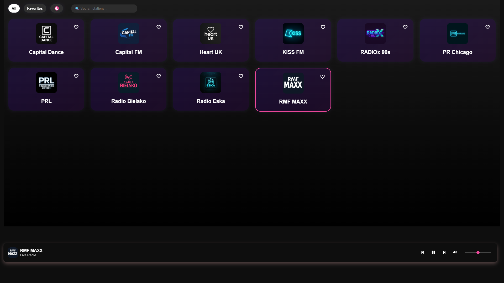
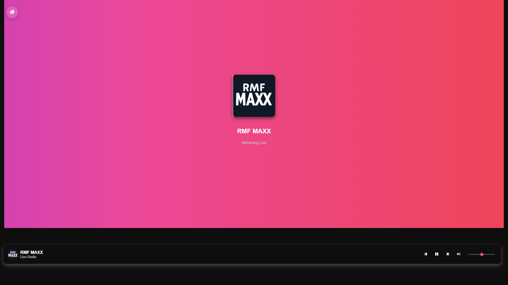
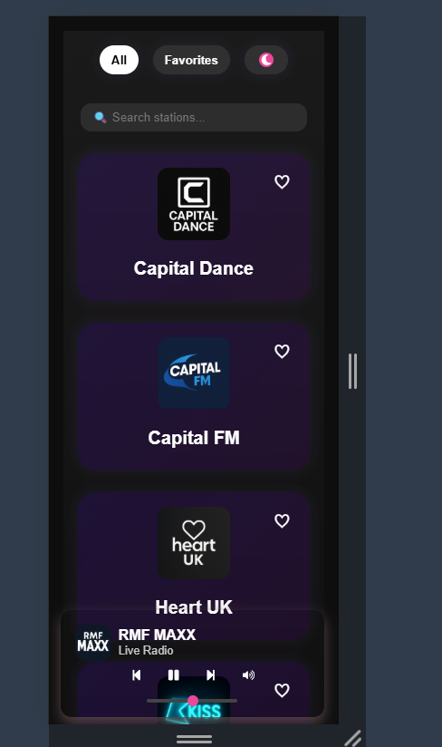
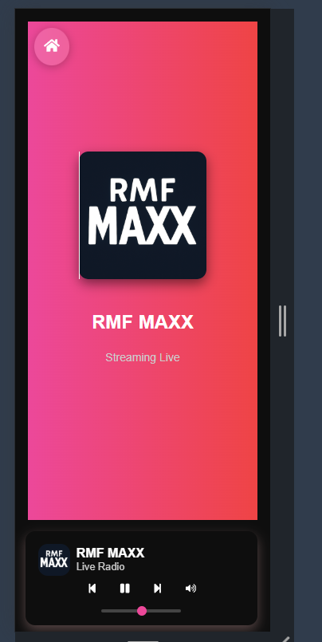

# 🌍 World Radio App

A web app that streams selected live internet radio stations. Built with **React**, **Vite**, **styled-components**, and **Context API**.

Supports:

- ✅ Live streaming with station switching
- ✅ Favorites (saved locally)
- ✅ Search and category filtering
- ✅ Responsive mobile/desktop layout
- ✅ Installable as a PWA (Android, desktop)
- ✅ Deployable to Google Play Store via Trusted Web Activity (TWA)

---

## 🔗 Live Demo

🌐 [World Radio App](https://worldradioapp.netlify.app)

---

## 📦 Folder Structure

```text
world-radio-app/
├── index.html                    # Vite HTML entry
├── vite.config.mjs               # Development and production build
├── jest.config.cjs               # Standalone React tests
├── eslint.config.mjs             # JavaScript, React and hooks checks
├── public/                       # Copied unchanged into the build
│   ├── icons/
│   ├── manifest.json
│   ├── offline.html
│   ├── _headers
│   └── _redirects
├── scripts/                      # Worker generation, build and browser checks
├── src/
│   ├── assets/                   # Radio logos and responsive variants
│   ├── components/               # Shared UI (.jsx)
│   ├── context/                  # Shared playback, favorites, theme and PWA
│   ├── data/                     # Stations and generated logo map
│   ├── lib/                      # Playback, storage and PWA logic
│   ├── pages/                    # Home.jsx and NowPlaying.jsx
│   ├── test/                     # Shared test fixtures
│   ├── App.jsx                   # Routes
│   └── main.jsx                  # Entry and providers
├── docs/
├── .nvmrc                        # Node 24
├── package-lock.json
└── package.json
```

---

## 🚀 Getting Started

```bash
# Clone the repo
git clone https://github.com/Silentmaster86/world-radio-app.git
cd world-radio-app

# Use the Node version in .nvmrc, then install locked dependencies
npm ci

# Run the development server
npm start
```

Open http://localhost:5173. Run `npm run check` for lint, formatting, regression
tests, a production build and the JavaScript budget. GitHub Actions
runs the same checks on pull requests. See [AGENTS.md](./AGENTS.md) for contributor
rules and [foundation notes](./docs/foundation.md) for favorites migration,
Netlify preview checks and remaining follow-up work.

---

## 🛠 Features

- 🎵 Stream internet radio stations
- 🔁 Switch stations (Next/Previous)
- 🔍 Search functionality
- ❤️ Add/remove favorite stations
- 📱 Mobile & car media-friendly
- 🧭 Media Session API support
- 📲 Add to Home Screen (PWA)
- 🧱 TWA-ready for Google Play

---

## 📱 PWA Support

Includes:

- `manifest.json`
- `service-worker.js`
- Media Session API for metadata + controls

### To test locally:

```bash
npm run build
npm run serve
```

Open [http://localhost:4173](http://localhost:4173).
Use DevTools → Application tab → Check Manifest and Service Worker

---

## 📤 Google Play Publishing (TWA)

1. Go to [https://www.pwabuilder.com](https://www.pwabuilder.com)
2. Enter `https://worldradioapp.netlify.app` as the app URL
3. Choose **Android (TWA)** and download the ZIP
4. Open in Android Studio, customize, and test
5. Upload `.aab` to Google Play Console and publish

---

## 📸 Screenshots

### Home Screen (Desktop)



### Now Playing View (Desktop)



### Home Screen (Mobile)



### Now Playing View (Mobile)



---

## 📃 License

This project is licensed under the MIT License.

---

## 🙌 Credits

Built by Przemyslaw Pietkun (https://github.com/Silentmaster86)  
Inspired by the simplicity of music and power of the web 🌐

Browsing, combined URL filters, the persistent player, system/light/dark appearance
and responsive logo generation are described in [docs/ux.md](docs/ux.md). The
`ux-browser` CI job checks the production build in Chromium and uploads its
screenshots, accessibility results and layout measurements for review.

Mobile layout, loading measurements and the initial JavaScript budget are
described in [docs/mobile-performance.md](docs/mobile-performance.md).

Installation, offline behavior, safe updates and PWA verification are documented
in [docs/pwa.md](docs/pwa.md). Offline access covers the app and saved stations;
live radio needs an internet connection.

Development commands, editor setup and the build/PWA contract are described in
[docs/tooling.md](docs/tooling.md).
