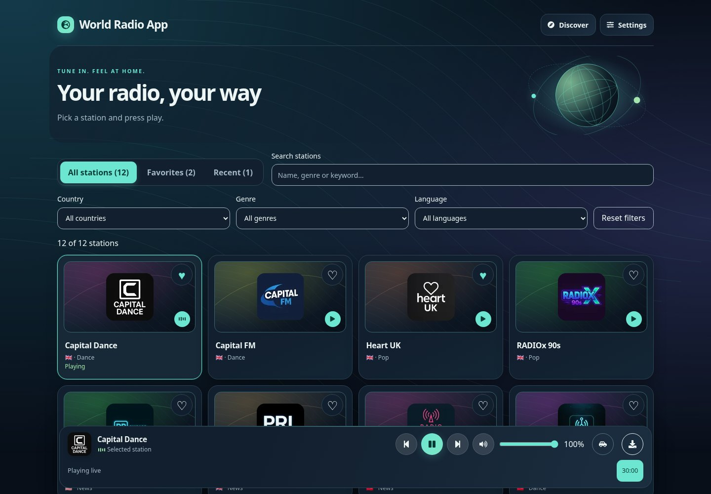
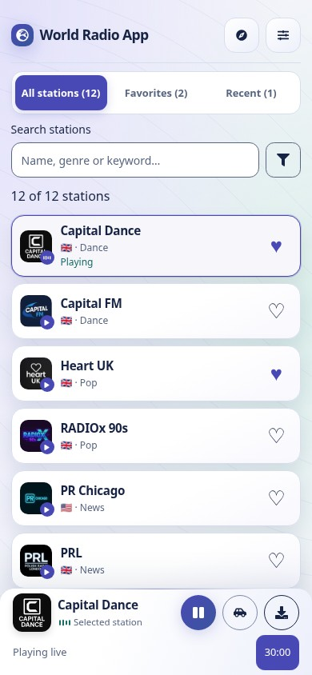
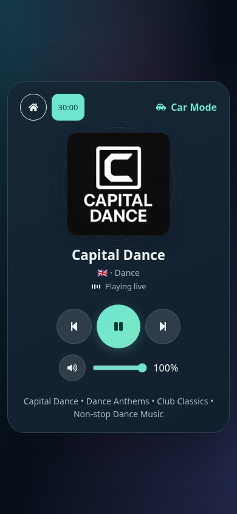
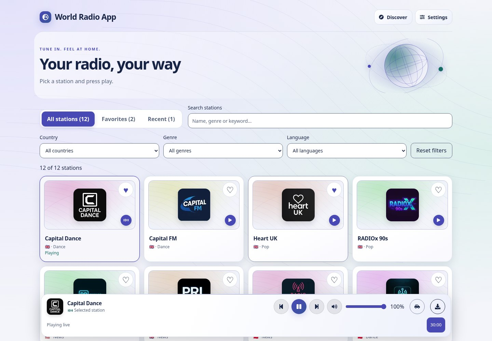

# World Radio App

Live radio from around the world, with your own station library and a player
that keeps running as you browse. A responsive, installable web app built with
React and Vite. No account required.

**[Open the live app](https://worldradioapp.netlify.app/)** ·
[Report a problem](https://github.com/Silentmaster86/world-radio-app/issues) ·
[Project roadmap](docs/roadmap.md)

[](https://github.com/Silentmaster86/world-radio-app/actions/workflows/ci.yml)



## What you can do

- **Discover radio worldwide.** Search the Radio Browser community directory by
  station name and country. Start with 12 curated stations and add your own
  discoveries. Play compatible HTTPS MP3, AAC and HLS streams.
- **Make it your library.** Save and reorder favorites, revisit recently played
  stations, filter by country/genre/language, remove added stations and share
  station links with a preview before playback.
- **Keep listening while you browse.** One shared player across the catalog,
  discovery and full-player views, with next/previous, volume, mute, a Sleep Timer
  and Media Session controls where supported by the browser and OS.
- **Take your library with you.** Export added stations, favorites, history and
  preferences to JSON, then preview and merge a backup on another device.
  Transfers are manual; each device keeps its own saved data.
- **Choose your appearance and language.** Light, dark and system themes,
  reduced-motion support and eight interface languages: English, Polish, German,
  Spanish, French, Portuguese, Italian and Ukrainian. Language changes preserve
  playback and the active timer.
- **Install it as a PWA.** Open the saved library and interface offline after
  setup, including all eight language packs. Live radio and new station searches
  need an internet connection. Updates wait for open app windows to close.

## A closer look

<table>
  <tr>
    <td align="center"><strong>Mobile library · light</strong></td>
    <td align="center"><strong>Full player · dark</strong></td>
  </tr>
  <tr>
    <td align="center"></td>
    <td align="center"></td>
  </tr>
</table>

<details>
<summary>Desktop in light mode</summary>



</details>

Screenshots show the running app. Station names and artwork belong to their
respective broadcasters.

## How it is built

| Area            | Implementation                                                      |
| --------------- | ------------------------------------------------------------------- |
| Interface       | React 19, React Router, styled-components and native CSS            |
| Shared state    | Context API and one event-driven audio controller across routes     |
| Playback        | Browser audio; hls.js loaded on demand where native HLS is absent   |
| Discovery       | Netlify Function querying Radio Browser with bounded mirror retries |
| Local data      | Validated localStorage records, stable station IDs and JSON backups |
| Languages / PWA | Separate language chunks and a versioned service-worker app shell   |
| Tooling         | Vite, Jest, ESLint, Prettier, Playwright, axe and GitHub Actions    |
| Hosting         | Netlify, with a deployment preview for each pull request            |

The player reports actual audio events, handles retry/offline states and avoids
restarting the stream when the interface changes. Offline caching covers the
application and saved library, not recordings of radio streams.

## Run locally

Use **Node.js 24** (see [.nvmrc](.nvmrc)) and npm.

```sh
git clone https://github.com/Silentmaster86/world-radio-app.git
cd world-radio-app
nvm use
npm ci
npm start
```

Open **http://localhost:5173**. If you do not use nvm, install Node 24 before
running the npm commands.

Vite serves the interface locally. Worldwide discovery uses the Netlify Function,
so use the [live app](https://worldradioapp.netlify.app/) or a Netlify deploy preview
to try that endpoint. `npm start` and `vite preview` alone do not run the function.
The curated stations and local library/player features do not require it.

To preview the production build and its service worker on a separate origin:

```sh
npm run build
npm run serve
```

Open **http://localhost:4173**. Development does not register the service worker.

## Quality and verification

```sh
npm run check
```

This runs lint, formatting, Jest, directory/stream/worker tests, a production
build, asset checks and the **128,000-byte gzip budget for initial JavaScript**.
Additional languages and the HLS fallback stay outside the initial bundle.

CI also checks the build and current PR preview in Chromium: real audio decoding,
mobile layouts, keyboard access, contrast, reduced motion, backup/import,
shared-player continuity and offline updates. The language suite covers **48
combinations** of eight languages, two themes and three viewport widths.
Screenshots and reports are available in the workflow artifacts.

Physical-device playback and system controls depend on the browser, OS and
publisher. See [device observations](docs/device-testing.md). Radio Browser is a
community directory; availability and broadcaster identity can vary. The Sleep
Timer can be delayed if the browser suspends the app.

## Project guide

```text
src/
  components/       Shared controls, player, settings, backup and library UI
  context/          Playback, stations, favorites, history, language, theme and PWA
  i18n/             Interface dictionaries and on-demand language packs
  lib/              Audio, storage, station identity, backup and browser helpers
  pages/            Catalog, discovery, library, shared station and full player
  styles/           Shared visual design and reduced-motion rules
netlify/functions/  Radio directory endpoint
scripts/            Build, service-worker generation and regression checks
docs/               Product behavior, technical notes and device observations
```

- [Playback and HLS](docs/playback.md) · [HLS details](docs/hls.md)
- [Discovery](docs/worldwide-discovery.md) · [Catalog and sources](docs/catalog.md)
- [Backup](docs/library-backup.md) · [Library management and sharing](docs/library-management.md)
- [Languages](docs/language.md) · [Visual design](docs/visual-design.md)
- [Installation, offline access and updates](docs/pwa.md)
- [Development workflow](docs/tooling.md) · [Contributor rules](AGENTS.md)

## Author and license

Created by **[Przemysław Pietkun](https://github.com/Silentmaster86)**.
The project declares the **MIT** license in [package.json](package.json).

Station discovery uses [Radio Browser](https://www.radio-browser.info/) and its
[public API](https://api.radio-browser.info/). Audio is delivered by broadcaster
stream endpoints; the app does not rebroadcast or translate it.
